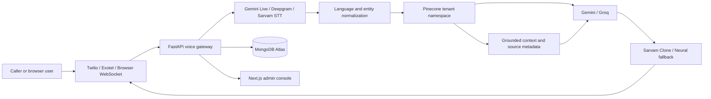

<div align="center">

# 🎙️ ZeniaOne Voice Assistant

### Enterprise-ready multilingual voice, chat, RAG, and telephony platform

[](https://fastapi.tiangolo.com/)
[](https://nextjs.org/)
[](https://www.python.org/)
[](https://www.typescriptlang.org/)
[](https://www.mongodb.com/atlas)
[](https://www.pinecone.io/)

<p>
  <a href="#-what-zeniaone-does">What it does</a> ·
  <a href="#-runtime-routing">Runtime routing</a> ·
  <a href="#-architecture">Architecture</a> ·
  <a href="#-quick-start">Quick start</a> ·
  <a href="#-testing">Testing</a>
</p>

</div>

<p align="center">
  
</p>

<p align="center">
  
</p>

<p align="center">
  <strong>Real-time voice intelligence for every customer conversation.</strong><br/>
  <sub>Listen clearly · reason with company knowledge · respond naturally · keep every turn observable</sub>
</p>

<p align="center">
  <a href="https://zeniaone-web.onrender.com/">
    
  </a>
  <a href="https://zeniaone-web.onrender.com/admin">
    
  </a>
  <a href="https://zeniaone-web.onrender.com/signup">
    
  </a>
</p>

<p align="center">
  <sub>Hosted production web app · click a button above to open it</sub>
</p>

---

## 🌟 What ZeniaOne does

ZeniaOne is a multi-tenant conversational AI platform for browser voice, text chat, inbound and outbound calls, knowledge-grounded answers, agent management, and usage analytics.

It combines:

- Real-time audio over WebSockets for browser and telephony channels.
- Gemini Live or streaming speech recognition for natural conversations.
- Gemini as the primary reasoning provider with Groq as a configurable fallback.
- Sarvam multilingual STT/TTS and authorized Sarvam cloned voices.
- Pinecone knowledge retrieval isolated by company namespace.
- MongoDB Atlas for tenants, agents, conversations, messages, settings, and usage.
- A Next.js administration console for routing, calls, knowledge, billing, and health monitoring.

The runtime is provider-driven: dashboard selections are stored, but every request is resolved again by the backend routing layer. This keeps the actual provider path explicit and makes fallbacks testable.

<p align="center">
  
  
  
  
</p>

### Product surface

<p align="center">
  
  
  
  
</p>

## ✅ Core capabilities

### Voice and telephony

- Browser voice sessions with streaming audio and live transcript events.
- Twilio Media Streams and Exotel audio-stream integrations.
- Native Gemini Live phone path for low-latency audio-to-audio conversations.
- Chained STT → RAG/LLM → TTS path when the selected profile needs a cloned voice.
- Sentence-level streaming TTS, barge-in cancellation, call state tracking, and usage accounting.
- Persisted greetings and assistant messages even when a provider does not emit an output transcript event.

### Multilingual support

- English, Hindi, Hinglish, Gujarati, and other supported Indian languages.
- Language-aware prompts and TTS language selection.
- Brand/entity normalization for product terms such as `ZeniaOne` and `ZeniaHR`.
- Provider fallback when a selected speech service is unavailable.

### Knowledge and RAG

- Company-isolated Pinecone namespaces using the company identifier.
- Semantic document chunking and metadata-aware document resolution.
- Candidate retrieval, score-based filtering, diversity selection, and context assembly.
- Knowledge-result caching, negative-result caching, retry/backoff, and timeout controls.
- Conversation-aware prompts and source metadata for grounded responses.

### Administration and operations

- Multi-tenant companies, owners, agents, channels, voices, documents, and conversations.
- Provider routing for browser voice, phone voice, and text chat.
- Health checks, activity logs, usage metrics, billing data, and admin controls.
- Tenant-aware authorization, validation, rate limiting, webhook verification, and encrypted provider configuration.

## 🔀 Runtime routing

The active route depends on the surface, the saved provider routing, and the agent voice engine. The following is the default order; administrators can change provider order from the routing controls.

```text
Phone voice
  STT:  Gemini Live → Deepgram
  LLM:  Gemini → Groq
  TTS:  Sarvam Clone → Neural fallback

Browser voice
  STT:  Gemini Live → Sarvam STT
  LLM:  Gemini → Groq
  TTS:  Sarvam Clone → Neural fallback

Text chat
  LLM:  Gemini → Groq
```

### Gemini + Clone Voice

```text
Caller/browser audio
  → Gemini speech understanding
  → Gemini/Groq answer generation
  → Sarvam Clone TTS
  → streamed audio response
```

The cloned-voice path requires a saved authorized Sarvam voice ID and `SARVAM_API_KEY`. ElevenLabs and IndicF5 are not part of the default runtime route in this branch.

### Native Gemini Live

```text
Caller/browser audio
  → Gemini Live audio-to-audio session
  → Gemini native output voice
```

This route has fewer intermediate stages and can be faster, but it does not use the selected Sarvam cloned voice.

## 🏗️ Architecture



## 🛠️ Technology stack

### Backend

- Python 3.11+, FastAPI, Uvicorn, asyncio, and WebSockets.
- MongoDB Atlas with Motor for application data and usage records.
- Pinecone with Sentence Transformers for vector retrieval.
- Gemini Live, Gemini, Groq, Deepgram, Sarvam STT/TTS, Twilio, and Exotel adapters.

### Frontend

- Next.js 15 App Router, React, and TypeScript.
- Admin console for overview, companies, agents, channels, calls, conversations, knowledge, routing, health, logs, and billing.
- Client-side GET caching and in-flight request deduplication for faster navigation.

## 📂 Project structure

```text
zeniaOne-Voice-Assistant/
├── zenaipex/
│   ├── ai/                 # RAG, embeddings, chunking, retrieval, prompts
│   ├── api/v1/             # REST and WebSocket endpoints
│   ├── core/               # Configuration, database, auth, security
│   ├── modules/            # Gemini Live, STT, TTS, audio adapters
│   ├── services/           # Routing, companies, conversations, billing
│   └── tests/              # Offline and regression tests
├── zenaipex-frontend/      # Next.js admin and customer applications
├── docs/                   # Operations, audits, architecture, and runbooks
├── scripts/                # Diagnostics, migrations, and maintenance tools
├── .env.example            # Environment variable template
└── README.md
```

## 🚀 Quick start

### Prerequisites

- Python 3.11+
- Node.js 18+
- MongoDB Atlas or MongoDB
- Pinecone index when knowledge retrieval is enabled
- Provider credentials for the channels and models you intend to use

### Backend

```bash
git clone --branch Farhan_work https://github.com/PULPIT221090/zeniaone_voice.git
cd zeniaone_voice
python -m venv .venv

# Windows PowerShell
.\\.venv\\Scripts\\Activate.ps1
pip install -r requirements.txt

copy .env.example .env
python -m uvicorn zenaipex.main:app --host 0.0.0.0 --port 8002 --reload
```

### Frontend

```bash
cd zenaipex-frontend
npm install
npm run dev
```

Open `http://localhost:3000` after configuring `NEXT_PUBLIC_API_URL`.

### Required configuration categories

Keep all secrets in the environment or the platform's encrypted secret store. Never commit them to GitHub.

```text
Application: APP_SECRET_KEY, APP_BASE_URL, FRONTEND_URL
Database: MONGODB_URI, MONGODB_DB_NAME
AI: GEMINI_API_KEY, GROQ_API_KEY
Speech: SARVAM_API_KEY, DEEPGRAM_API_KEY
RAG: PINECONE_API_KEY, PINECONE_INDEX_NAME
Telephony: TWILIO_* and/or EXOTEL_*
Frontend: NEXT_PUBLIC_API_URL
```

### Telephony webhook examples

Twilio and Exotel must be configured to reach the deployed backend over secure WebSockets. Use the exact company, agent, and channel identifiers generated by the application.

```text
wss://<backend-domain>/api/v1/webhook/twilio/media-stream
wss://<backend-domain>/api/v1/webhook/exotel/advanced/<company_id>/<agent_id>/media-stream
```

## 🧪 Testing

Run offline tests before changing a provider route or deploying:

```bash
pytest -q
python -m compileall zenaipex
```

Useful focused suites include:

```bash
pytest -q zenaipex/tests/test_gemini_phone_live.py
pytest -q zenaipex/tests/test_clone_stream_dispatch.py
pytest -q zenaipex/tests/test_gemini_twilio_live.py
pytest -q zenaipex/tests/test_customer_guard_and_language.py
```

These tests mock provider boundaries where possible. They do not replace an authorized staging call, carrier verification, or a labeled multilingual speech benchmark.

## 🔐 Security and responsible use

- Use only authorized voice samples and consented recordings for voice cloning.
- Keep API keys, database credentials, webhook secrets, and recording URLs private.
- Keep each tenant's documents and vectors scoped to its company namespace.
- Use HTTPS/WSS in every hosted environment.
- Rotate any credential that has been exposed in logs, screenshots, chat, or source files.
- Review provider terms and licensing before commercial deployment of any self-hosted speech model.

## 📌 Production notes

The repository contains the application and deployment configuration; production behavior also depends on Render service settings, environment variables, provider account limits, carrier configuration, MongoDB indexes, and Pinecone readiness. Provider dashboards must therefore be checked together with application logs when diagnosing latency or missing transcripts.

For a production rollout, validate in this order:

1. Backend health and database connectivity.
2. Provider inventory and saved runtime routing.
3. Audio format, language, transcript, and turn-completion events.
4. RAG namespace, retrieved chunks, and source evidence.
5. Answer groundedness and fallback behavior.
6. Call recording, transcript persistence, usage, and billing metrics.

## 👨‍💻 Author

**Farhan Kureshi**

- GitHub: [@farhanzeniapex-a11y](https://github.com/farhanzeniapex-a11y)
- Repository: [PULPIT221090/zeniaone_voice](https://github.com/PULPIT221090/zeniaone_voice/tree/Farhan_work)

<div align="center">
  <sub>Built for reliable, multilingual, knowledge-grounded customer conversations.</sub>
</div>
