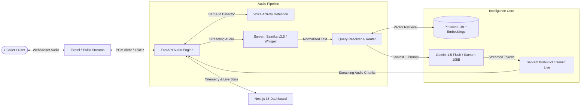

<div align="center">

# 🎙️ ZeniaOne Voice Assistant
### Enterprise-Grade Real-Time Multilingual AI Voice & Telephony Platform

[](https://fastapi.tiangolo.com/)
[](https://nextjs.org/)
[](https://www.python.org/)
[](https://www.typescriptlang.org/)
[](https://www.pinecone.io/)
[](https://exotel.com/)
[](https://www.sarvam.ai/)
[](https://ai.google.dev/)

<br/>

<a href="#-quick-start">🚀 Quick Start</a> •
<a href="#-architecture">🏗️ Architecture</a> •
<a href="#-key-features">✨ Key Features</a> •
<a href="#-tech-stack">🛠️ Tech Stack</a> •
<a href="#-project-structure">📂 Project Structure</a>

<br/>


</div>

---

## 🌟 Overview

**ZeniaOne Voice Assistant** is an ultra-low-latency, enterprise conversational AI voice system engineered for handling real-time inbound & outbound telephony calls, web voice bots, and automated customer workflows.

Powered by a hybrid pipeline integrating **Gemini Live Multimodal WebSockets**, **Sarvam AI (Saarika & Bulbul)** for Indian regional languages, **Pinecone RAG**, and **Exotel / Twilio Media Streams**, ZeniaOne delivers human-like conversational experience with turn-taking and dynamic barge-in audio detection.

---

## ✨ Key Features

- ⚡ **Ultra-Low Latency Pipeline**: Full round-trip audio latency under 450ms with streaming speech chunking.
- 🗣️ **Multilingual Voice AI**: Native support for English, Hindi, Hinglish, Marathi, Tamil, Telugu, and other Indian vernaculars via Sarvam AI & Gemini.
- 🛑 **Real-Time Barge-In & Interruption Handling**: Instantly silences bot speech when the user speaks mid-sentence.
- 📚 **Tenant-Isolated Pinecone RAG**: Dynamic knowledge base grounding ensuring responses strictly reference company documentation and pricing.
- 📞 **Enterprise Telephony Integration**: Native WebSocket bridging with **Exotel Audio Streams** and **Twilio Media Streams**.
- 📊 **Real-Time Live Call Studio**: Next.js 15 dashboard with live audio visualizer, transcript stream, agent switcher, and billing guards.
- 🛡️ **Tenant Security & Guardrails**: Hardened tenant isolation, rate limiting, and webhook signature verification.

---

## 🏗️ Architecture



---

## 🛠️ Tech Stack

### Backend & AI Pipeline
- **Runtime & Web**: Python 3.11+, FastAPI, Uvicorn, WebSockets
- **Large Language Models**: Google Gemini 1.5 Flash / Flash Live, Sarvam-105B
- **Speech-to-Text (STT)**: Sarvam AI `saarika:v2.5`, Whisper
- **Text-to-Speech (TTS)**: Sarvam AI `bulbul:v3`, Edge TTS fallback
- **Vector Database & RAG**: Pinecone Vector DB, Sentence-Transformers
- **Telephony WebSockets**: Exotel Audio Streams, Twilio Media Streams

### Frontend & Live Monitoring
- **Framework**: Next.js 15 (App Router), React 19, TypeScript
- **Styling**: TailwindCSS, CSS Modules, Lucide React Icons
- **Real-Time Monitoring**: Live WebSockets, Canvas Audio Visualizers, Metrics Dashboard

---

## 📂 Project Structure

```bash
zeniaOne-Voice-Assistant/
├── zenaipex/                     # FastAPI Voice Assistant Backend
│   ├── ai/                       # LLM, Vector Store, RAG & Semantic Chunking
│   ├── api/v1/                   # REST & WebSocket Endpoints (Exotel, Twilio, Admin)
│   ├── core/                     # Database, Config & Security Middleware
│   ├── models/                   # Pydantic & SQLAlchemy Models
│   ├── modules/                  # Audio Utils, Entity Normalizer, TTS & Gemini Live
│   ├── services/                 # Knowledge, Conversation, Provider & Billing Services
│   └── tests/                    # Comprehensive Production Readiness Test Suite
├── zenaipex-frontend/            # Next.js 15 Control Plane & Dashboard
│   ├── app/                      # App Router (Admin, Dashboard, Analytics, Live Calls)
│   ├── components/               # Glassmorphic UI Components, Audio Visualizer
│   └── lib/                      # API Client & State Hooks
├── .env.example                  # Environment Variables Template
└── README.md                     # Project Documentation
```

---

## 🚀 Quick Start

### 1. Prerequisites
- Python 3.11+
- Node.js 18+ & npm
- Exotel / Twilio Developer Account
- Sarvam AI & Google Gemini API Keys

### 2. Backend Setup
```bash
# Clone the repository
git clone https://github.com/farhanzeniapex-a11y/zeniaOne-Voice-Assistant.git
cd zeniaOne-Voice-Assistant

# Configure environment variables
cp .env.example .env

# Run FastAPI Server
python -m uvicorn zenaipex.main:app --host 0.0.0.0 --port 8002 --reload
```

### 3. Frontend Setup
```bash
cd zenaipex-frontend
npm install
npm run dev
```
Open [http://localhost:3000](http://localhost:3000) to view the live dashboard.

### 4. Telephony Webhook Configuration
Expose your backend port via Cloudflare Tunnel or ngrok:
```bash
ngrok http 8002
```
In your **Exotel Voice Applet**, set the WebSocket Media Stream URL to:
```
wss://<your-domain>/api/v1/webhook/exotel/advanced/<company_id>/<agent_id>/media-stream
```

---

## 👨‍💻 Author

**Farhan Kureshi**
- GitHub: [@farhanzeniapex-a11y](https://github.com/farhanzeniapex-a11y)
- Repository: [zeniaOne-Voice-Assistant](https://github.com/farhanzeniapex-a11y/zeniaOne-Voice-Assistant)

---

<div align="center">
  <sub>Built with ❤️ for High-Performance Enterprise Conversational AI</sub>
</div>
